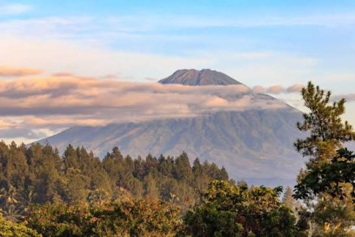

# Hiking & Camping on a Mountain

Sometime early-2024. I, alongside my father, and my little brother. Went on a hiking/mountaineering adventure in Indonesia. We climbed and summitted Subming (3,371m Peak) across 2 days.

If I'm being honest, the hike up wasn't anything spectacular. It's just forest most of the way up until you approach the peak, then its mostly rocks and shrubbery. What stood out about it was camping on the mountains. Being so far away from the closest major city means you're able to look up and see so many stars. It's genuinely unlike anything I've seen before.

It's not a particularly hard mountain so summit. It's just a walk up and down a really big hill, effectively. As long as you have decent cardio and know what to pack, you'll be fine.

Overall, I rate this experience a C+.

