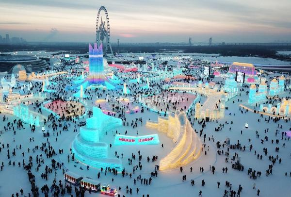

# Multi-week Asia Tour

During the December 2024-2025 Holiday season. Me and my family went on an excursion of a lifetime. a 2 week long adventure holiday spanning 3 nations. China (1.5 weeks), Malaysia (3 days), and Singapore (1 day).

I don't have much to say about Malaysia and Singapore due to how little time I spent in either nations. However, I have lots to say about China! This fact isn't really well known, but I consider myself "vaguely trilingual". I can order food, and ask for directions in Mandarin Chinese. In addition of that, my family is of Chinese heritage, so this trip honestly was long overdue.
We spent most of our time in three major cities. Beijing (Capital), Xi'an, and Harbin.

Beijing and Xi'an are largely, standard, Chinese cities. I can talk about their technology, unique culture and history, and food. In this assignment, I want to talk about Harbin. When we visited Harbin, it was so, so, so, cold. I know we're in Canada, and we love to complain about the weather. But Harbin is some other machine. We unfortunately visited Harbin in a significantly colder winter. Temperatures reached below -25C at one point with humidity and wind chills very easily making it feel like -35C to -40C. Weather aside, Harbin culture is unlike anything I've come to expect from China. It's so, Russian? Harbin is in quite close proximity to Siberia, so I understand if there are historical reasons for it, but, Harbin is such a unique city. I would love to visit again someday. Though, maybe not during a colder than usual winter...

I rate this experience, and the whole trip in general, an A+.

