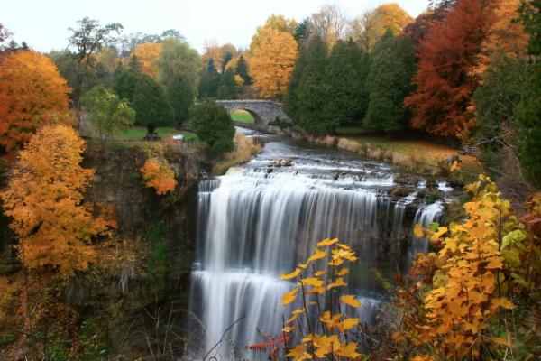

# Autumn in Hamilton ON

When I first arrived in Canada. I was quite lost, didn't really know what to do, where to go, or really what the country had to offer. One of my first trips was to Hamilton, sometime October 2025. Specifically, one of their waterfalls.

Now I didn't know it at the time, but Hamilton and many cities around Southern Ontario (Inluding Brantford) has a lot of trails. Hamilton included. I stumbled upon one of their trails, and in a moment of impulsivity or rather "i have no idea what to do", I decided to walk down the trail for an hour.

It was, the most beautiful walk I've ever been on. I've always loved how Autumn looked, and being fully immersed in the chill Autumn air and seeing the multicolor leaves all around is a moment worth remembering. I did have to walk, quite a lot, to the nearest station to get home, though. That wasn't as fun.

Overall, I'd give the experience a C+.

